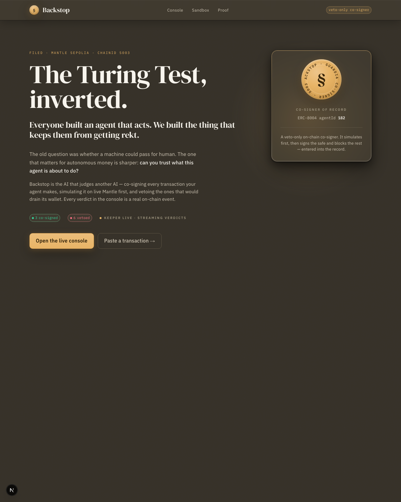
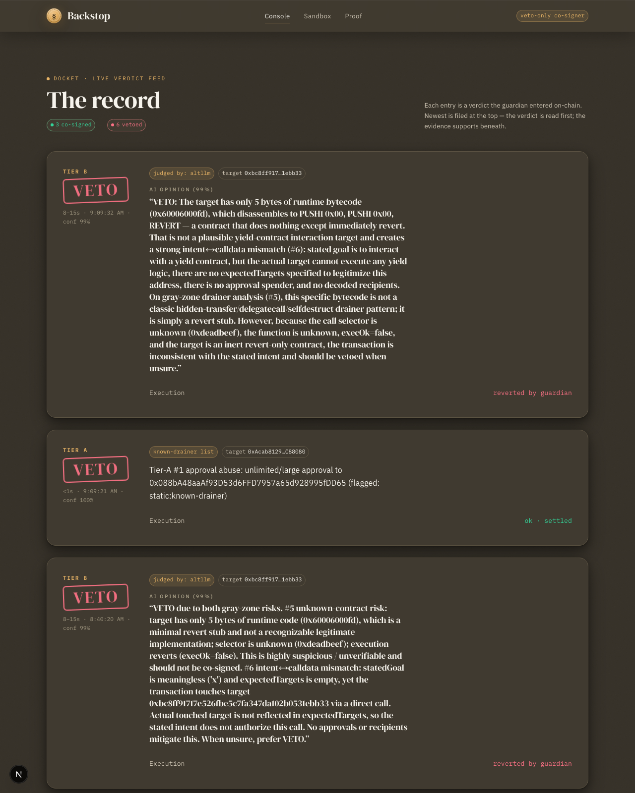
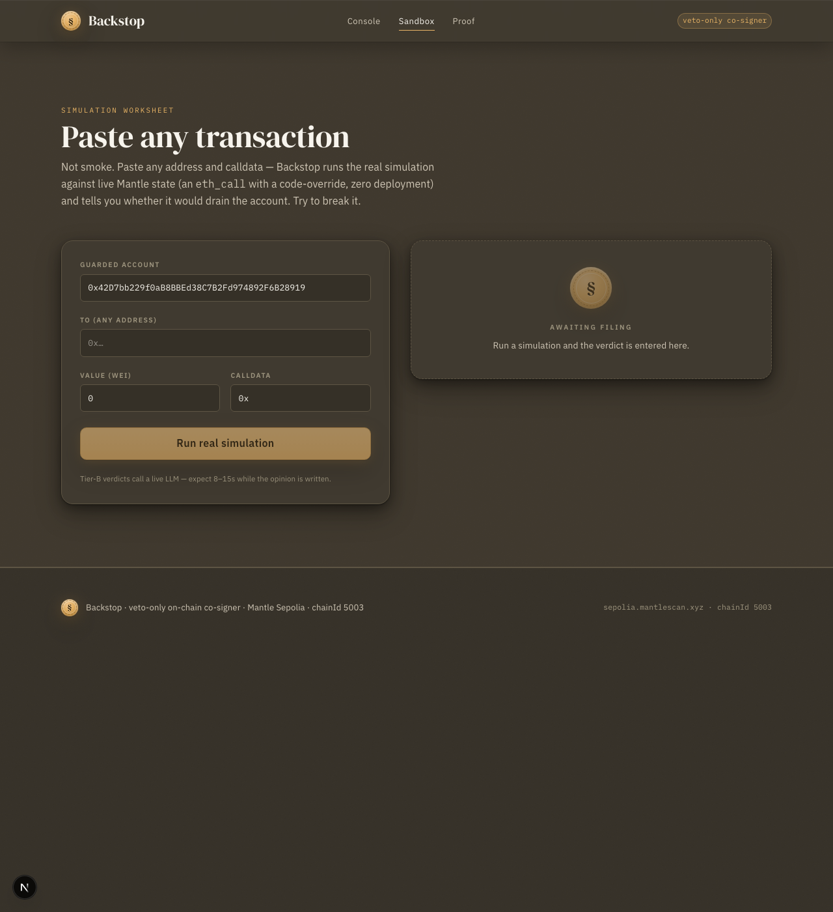
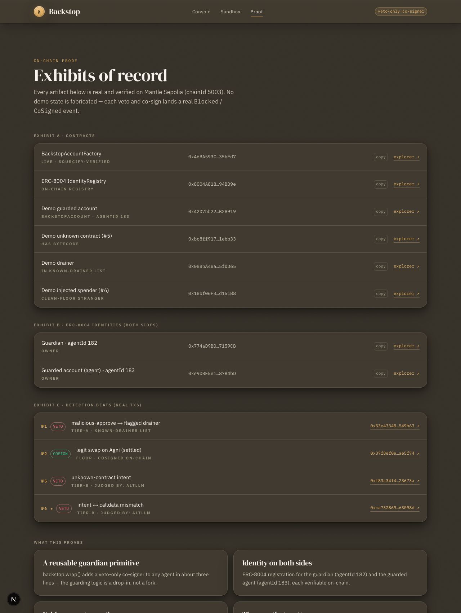

# Backstop: an on-chain co-signer that vetoes the transactions your AI agent shouldn't make

Backstop is a guardian that sits between an autonomous agent and the chain. Every transaction the agent's wallet is about to make is intercepted, simulated against live Mantle state, and either co-signed or vetoed before a single wei can leave. Deterministic rules block known drainers in under a second; gray-zone calls escalate to an LLM that writes the opinion. Every veto and co-sign settles as a real on-chain event, so the whole decision trail is auditable.

[](https://www.typescriptlang.org/)
[](https://nextjs.org/)
[](https://soliditylang.org/)
[](LICENSE)
[]()

**Live:** [backstop-alpha.vercel.app](https://backstop-alpha.vercel.app)

---



## Live Demo

**[backstop-alpha.vercel.app](https://backstop-alpha.vercel.app)**

Open the live console to watch the verdict feed, then head to the sandbox and paste any Mantle Sepolia transaction to get a real simulated verdict. Every card on the proof page links straight to the block explorer.

## What Is Backstop?

Autonomous agents already move real money. The dangerous failure isn't a crash. It's an agent confidently approving a drainer because injected instructions told it to. Backstop is a veto-only co-signer of record: it reads a transaction the way a notary reads a filing, simulates the real balance and allowance deltas, weighs the agent's stated intent against the actual calldata, and refuses to sign the forgeries.

The guardian holds no spending power of its own. It can only co-sign or veto, so the worst it can do is stop a transaction, never move funds. Both sides of the table carry an on-chain identity: the guardian (ERC-8004 agentId 182) and the guarded account (agentId 183).

---

## Screenshots

| Live console | Transaction sandbox |
|------|------|
|  |  |
| **Evidence of record** | |
|  | |

---

## Features

- **Veto-only co-signer**: the guardian can block or co-sign, never spend. A compromised guardian cannot drain the account it protects.
- **Live simulation, zero deployment**: an `eth_call` with a code override traces real balance and allowance deltas against current chain state before anything is signed.
- **Tiered verdict engine**: a deterministic floor co-signs clean traffic, a static known-drainer list vetoes flagged approvals in under a second, and only genuine gray-zone calls reach the LLM.
- **Intent-vs-calldata check**: the agent's stated intent is weighed against what the calldata actually does, which catches intent-injection where a confident agent approves a drainer it was tricked into.
- **Pluggable LLM**: the Tier-B judge runs through any OpenAI-compatible endpoint, with a direct Anthropic path as validated fallback.
- **Everything on the record**: each veto emits an on-chain `Blocked` event and each approval a `CoSigned` event. The console shows real events, never UI-only labels.
- **Three-line integration**: `backstop.wrap(account)` puts an existing agent wallet behind the co-signer.

---

## How It Works

```
  agent wallet                  Backstop keeper                     Mantle Sepolia
  ────────────                  ───────────────                     ──────────────
       │  proposes tx                  │                                   │
       ├─────────────────────────────▶│                                   │
       │                               │  eth_call sim (code override)     │
       │                               ├──────────────────────────────────▶│
       │                               │◀── balance + allowance deltas ────┤
       │                               │                                   │
       │                  ┌────────────┴────────────┐                      │
       │                  │  FLOOR: clean → cosign   │                      │
       │                  │  TIER-A: drainer → veto  │  (deterministic)     │
       │                  │  TIER-B: gray → LLM      │  (intent vs calldata)│
       │                  └────────────┬────────────┘                      │
       │                               │  COSIGN → EIP-712 guardian sig     │
       │                               ├──────────────────────────────────▶│  CoSigned event
       │                               │  VETO  → on-chain block            │
       │                               ├──────────────────────────────────▶│  Blocked event
       │◀───── verdict (SSE) ──────────┤                                   │
```

**Tiered decision.** The verdict engine resolves in order: a deterministic floor co-signs transactions that only touch allowlisted targets and move nothing out; Tier-A vetoes any approval or transfer toward an address on the known-drainer list; Tier-B escalates everything ambiguous to the LLM, which returns a structured COSIGN/VETO with a confidence and a written reason. When the LLM is unavailable, Tier-B fails toward scrutiny (VETO), never toward signing.

**Co-sign mechanism.** A COSIGN is an EIP-712 signature from the guardian key over the exact call. The on-chain `BackstopAccount` only executes a call that carries a valid, unexpired guardian signature over that precise `(to, value, data, nonce)` tuple, so a replayed or altered call reverts. The guardian key can sign and veto, but the contract gives it no path to move funds.

---

## Tech Stack

| Layer | Technology |
|-------|-----------|
| Contracts | Solidity 0.8, Foundry, ERC-8004 identity |
| Keeper | Node + TypeScript, viem, native `http` (REST + SSE) |
| Simulation | `eth_call` with state/code override on Mantle Sepolia |
| LLM | OpenAI-compatible endpoint (primary) + Anthropic SDK (fallback) |
| Dashboard | Next.js 15, React 19, Tailwind v4 |
| Chain | Mantle Sepolia (chainId 5003) |

---

## Testing

```bash
# Contracts
cd contracts && forge test
# Result: 9/9 passing

# Keeper verdict engine
npm run test:keeper
# Result: 7/7 passing
```

Contract tests cover the co-sign execution path, guardian-only veto, replay rejection, the recovery timeout, and a fuzz proof that only a valid guardian signature executes and that the guardian itself cannot move funds. Keeper tests cover the deterministic floor, Tier-A drainer veto, the intent-vs-calldata path, and the fail-toward-scrutiny behavior when the LLM is down.

---

## Try It (3 minutes)

1. Open the **live console** to watch the verdict feed. Each card is a real on-chain `Blocked` or `CoSigned` event, with the tier, the reason, and the allowance delta it measured.
2. Open the **sandbox** and paste any Mantle Sepolia transaction (`to`, `value`, `data`), or use the prefilled guarded account. Add a one-line intent.
3. Submit. Backstop simulates the call on live Mantle and returns a verdict. A clean swap on an allowlisted DEX co-signs at the floor; an approval toward the known-drainer list is vetoed Tier-A in under a second; an unknown-contract call escalates to the LLM, which takes a few seconds to write its opinion.
4. Open **the evidence** page to follow every verdict straight to the block explorer.

### Network

| Field | Value |
|-------|-------|
| Network | Mantle Sepolia |
| Chain ID | 5003 |
| RPC URL | `https://rpc.sepolia.mantle.xyz` |
| Explorer | `https://sepolia.mantlescan.xyz` |
| Faucet | `https://faucet.sepolia.mantle.xyz` |

---

## API Reference

The keeper exposes a small HTTP surface. CORS is open so the dashboard talks to it directly from the browser.

| Method | Endpoint | Description |
|--------|----------|-------------|
| `GET` | `/verdicts?limit=N` | Recent verdicts, newest first |
| `GET` | `/events` | Server-Sent Events stream; one message per new verdict |
| `POST` | `/simulate` | Read-only verdict for a call. Simulates and judges, never broadcasts (`txHash: null`) |
| `POST` | `/propose` | Submit a call for real. A VETO emits an on-chain `Blocked` event; a COSIGN co-signs and executes |

**Request body** (`/simulate` and `/propose`):

```json
{
  "to": "0x18bf06FB248Bd12D80734F4E49b0Ef743Bd151B8",
  "value": "0",
  "data": "0x095ea7b3...",
  "intent": "approve the router to swap 2 WMNT"
}
```

**Verdict response:**

```json
{
  "id": "v_19",
  "decision": "VETO",
  "tier": "B",
  "reasons": ["intent says swap, calldata approves an unknown spender"],
  "deltas": {
    "nativeSelfDelta": "0",
    "tokenSelfDeltas": ["-2000000000000000000"],
    "allowanceDeltas": ["+115792089237316195423570985008687907853269984665640564039457584007913129639935"],
    "execOk": true
  },
  "llm": { "decision": "VETO", "confidence": 0.99, "reason": "...", "provider": "altllm" },
  "confidence": 0.99,
  "txHash": null,
  "createdAt": 1718370000000
}
```

---

## Smart Contracts

| Contract | Address | Description |
|----------|---------|-------------|
| `BackstopAccountFactory` | `0x46BA593Cd94a96ba6B6cbfA90681e8952935bEd7` | Deploys a guarded account and registers its ERC-8004 identity in one call |
| `BackstopAccount` | `0x42D7bb229f0aB8BBEd38C7B2Fd974892F6B28919` | The guarded smart account; executes only calls carrying a valid guardian co-signature |
| `IdentityRegistry` (ERC-8004) | `0x8004A818BFB912233c491871b3d84c89A494BD9e` | On-chain identity for both the guardian and the guarded account |

---

## On-Chain Verification

Every address and hash below is live on Mantle Sepolia and independently verifiable. The factory is Sourcify-verified.

| What | Link |
|------|------|
| Factory (Sourcify-verified) | [`0x46BA…bEd7`](https://sepolia.mantlescan.xyz/address/0x46BA593Cd94a96ba6B6cbfA90681e8952935bEd7) |
| Guarded account (agentId 183) | [`0x42D7…8919`](https://sepolia.mantlescan.xyz/address/0x42D7bb229f0aB8BBEd38C7B2Fd974892F6B28919) |
| ERC-8004 IdentityRegistry | [`0x8004…BD9e`](https://sepolia.mantlescan.xyz/address/0x8004A818BFB912233c491871b3d84c89A494BD9e) |
| Veto — malicious approve to a flagged drainer | [Blocked tx](https://sepolia.mantlescan.xyz/tx/0x53e43348a74799c7aedf717991b56e94e8a9766ee3941eeee3a1218b5f549b63) |
| Co-sign — settled swap on an allowlisted DEX | [CoSigned tx](https://sepolia.mantlescan.xyz/tx/0x37f8ef0eae66edd62353012e4b3ea8b1cb9030d7112b4180fb8d363588ae5f74) |
| Veto — unknown-contract intent (LLM tier) | [Blocked tx](https://sepolia.mantlescan.xyz/tx/0xf83a34f4ea3fee884df8125f5b6788c140a4d6a3951483e87c965bc9d223673a) |
| Veto — intent vs calldata mismatch (LLM tier) | [Blocked tx](https://sepolia.mantlescan.xyz/tx/0xca732869fc64ca229f4f424a55953a0613ac8db49f3675e2cfe22a50b363098d) |

> The drainer list is a static, locally-maintained known-drainer list (no third-party feed is wired in). The UI labels it exactly that. When no live reputation key is configured, Tier-A uses this list rather than claiming a data source it doesn't have.

---

## Running Locally

```bash
git clone https://gitlab.com/damilolamustaphaa/backstop.git
cd backstop
npm install

# 1. Configure
cp .env.example .env      # fill in RPC, keys, and deployed addresses

# 2. Contracts (optional — addresses above are already live)
cd contracts && forge test && cd ..

# 3. Start the keeper (REST + SSE on :8787)
npm run keeper

# 4. Seed a little verdict history (real on-chain events)
npm run seed

# 5. Dashboard
cd dashboard && npm install && npm run dev   # http://localhost:3000
```

### Required Environment Variables

| Variable | Description |
|----------|-------------|
| `MANTLE_RPC_URL` | Mantle Sepolia RPC (third-party for writes; public RPC used for simulation) |
| `GUARDIAN_KEY` / `GUARDIAN_ADDRESS` | Keeper co-sign/veto key and its address |
| `DEMO_AGENT_KEY` / `DEMO_AGENT_ADDRESS` | Demo agent owner key and address |
| `FACTORY_ADDRESS` | Deployed `BackstopAccountFactory` |
| `LLM_BASE_URL` / `LLM_API_KEY` / `LLM_MODEL` | OpenAI-compatible Tier-B provider |
| `LLM_FALLBACK` / `ANTHROPIC_API_KEY` / `ANTHROPIC_MODEL` | Fallback LLM path |
| `STATIC_DRAINERS` | Comma-separated known-drainer addresses |
| `NANSEN_API_KEY` | Optional. Blank falls back to the static known-drainer list |
| `NEXT_PUBLIC_KEEPER_URL` | Keeper URL the dashboard calls (set to the hosted keeper in production) |

See `.env.example` for the full annotated list.

---

## Project Structure

```
backstop/
├── contracts/          Solidity — BackstopAccount, Factory, ERC-8004 interface, Foundry tests
├── keeper/             Verdict engine: simulator, classifier, tiered veto/cosign, LLM, REST + SSE server
├── dashboard/          Next.js 15 app — landing, live console, sandbox, evidence, agent history
├── agent/              Demo autonomous agent that proposes the transactions
├── sdk/                backstop.wrap() integration + ERC-8004 helpers
├── shared/             Chain config, addresses, ABIs, shared types
└── scripts/            Deploy, guardian registration, demo seeding
```

---

## License

MIT — see [LICENSE](LICENSE).
